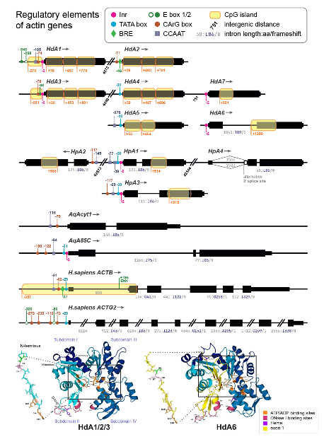
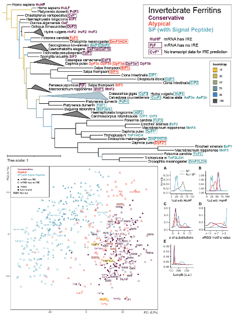
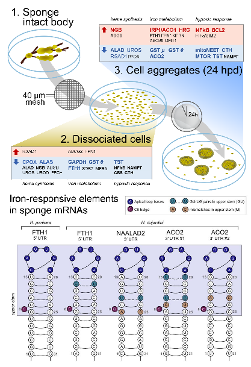

# Kim Fehl Adameyko

**Bioinformatician, PhD in Genetics | Open to bioinformatician roles in biotech and research | [LinkedIn](https://www.linkedin.com/in/kim-fehl/)** 

A mathematically trained bioinformatician working 
at the interface of developmental and evolutionary 
biology in non-model, early-branching animals.

I bring seven years of experience across biotech and academic research. My work spans genome assembly and annotation, bulk and single-cell RNA-seq, and reproducible pipeline development. 

I enjoy taking ownership of under-defined problems, 
building reproducible analyses, and communicating 
results through engaging writing and data-rich 
visualisations.

## Skills

**Research fields:** Comparative genomics · Transcriptomics · Developmental biology · Marine invertebrates  
**Bioinformatic protocols:** Hybrid genome assembly · *de novo* transcriptome assembly · Phylogenetic analyses · Metagenomics · Bulk and single-cell transcriptomics · Protein and RNA structure · Mass-spectrometry data processing  
**Programming languages:** Python · R · Bash · C++/C# · Perl · SQL · Wolfram Language · MATLAB  
**Pipelines, cloud and ML:** Nextflow · Snakemake · Make · AWS CLI · UGE · Docker · Git  
**Visualisation:** Scientific visualisation · Adobe Illustrator · Adobe Photoshop · PyMOL · UCSF Chimera · ImageJ  
**Languages:** English (proficient) · Russian (native) · French (B1) · Hebrew (A1)

## Selected analysis projects

### [Halisarca transcriptomics](https://github.com/kim-fehl/Halisarca-dujardinii-transcriptomics/tree/main/differential_expression)

**Snakemake · R · edgeR**

Developed a configurable workflow for studying sponge cell reaggregation, from FASTQ preprocessing and alignment to differential expression, QC and heatmaps reused across research articles. 

### [Sycon transcriptomics](https://github.com/kim-fehl/Sycon-ciliatum-transcriptomics)

**Nextflow · R · DeSeq2**

Analysis workflow covering 38 RNA-seq libraries across development and regeneration. 

## Open-source contributions

### nf-core/scdownstream — single-cell RNA-seq pipeline

**Nextflow · Python · Docker · GitHub CI/CD**  
Contributed during a Nextflow hackathon, working with maintainers to improve resource use and container dependencies.

- **Reduced container disk usage by 25% (60 → 45 GB)** by consolidating Python modules into shared container images and resolving dependency conflicts. [Merged PR #271](https://github.com/nf-core/scdownstream/pull/271)
- **Halved runtime for the complete minimal test profile (58 → 29 min)** by passing the allocated CPU count to SingleR's threading parameter. [Merged PR #262](https://github.com/nf-core/scdownstream/pull/262)

### AGAT — genome annotation toolkit

**Perl · GitHub CI/CD** 
- Implemented deterministic output, consistent verbosity controls and parallel test execution; **reduced the coverage job runtime by approximately 45% (22 → 12 min)**. Most proposals from [PR #559](https://github.com/NBISweden/AGAT/pull/559) were subsequently reimplemented by the maintainer in [merged PR #549](https://github.com/NBISweden/AGAT/pull/549).

## Featured publications

<table border="0" cellpadding="0" cellspacing="0" style="border:0; border-collapse:collapse;">
<tr>
<td width="33%" valign="top" style="border:0; padding:0 10px 8px 0;">

</td>
<td width="33%" valign="top" style="border:0; padding:0 10px 8px 0;">

</td>
<td width="33%" valign="top" style="border:0; padding:0 10px 8px 0;">

</td>
</tr>
<tr>
<td width="33%" valign="top" style="border:0; padding:0 10px 8px 0;">

Lyupina*, <strong>Adameyko*</strong>, Zubarev* et al. 
<strong>The Divergent Intron-containing Actin in Sponge Morphogenetic Processes</strong> 
<em>NAR Genom. Bioinf., 2025</em>

</td>
<td width="33%" valign="top" style="border:0; padding:0 10px 8px 0;">

<strong>Adameyko</strong> et al. 
<strong>Conserved and Atypical Ferritins of Sponges</strong> 
<em>Int. J. Mol. Sci., 2021</em>

</td>
<td width="33%" valign="top" style="border:0; padding:0 10px 8px 0;">

Finoshin*, <strong>Adameyko*</strong> et al. 
<strong>Iron Metabolic Pathways in the Processes of Sponge Plasticity</strong> 
<em>PLOS One, 2020</em> * contributed equally

</td>
</tr>
<tr>
<td width="33%" valign="top" style="border:0; padding:0 10px 8px 0;">
<ul>
<li>Analysed cell-type-specific actin gene expression by integrating single-cell and bulk RNA-seq data.</li>
<li>Investigated actin regulatory elements, intron locations and functional binding residues.</li>
</ul>
</td>
<td width="33%" valign="top" style="border:0; padding:0 10px 8px 0;">
<ul>
<li>Identified non-conserved, lowly expressed sponge ferritins lacking iron-responsive elements.</li>
<li>Compiled a comparative dataset of invertebrate ferritins and analysed it using machine-learning techniques.</li>
</ul>
</td>
<td width="33%" valign="top" style="border:0; padding:0 10px 8px 0;">
<ul>
<li>Assembled genomes and <em>de novo</em> transcriptomes of two sponges.</li>
<li>Analysed differential expression of iron-metabolism genes during whole-body regeneration.</li>
</ul>
</td>
</tr>
</table>

[Full Publications List (ORCID)](https://orcid.org/0000-0002-5429-3051)

